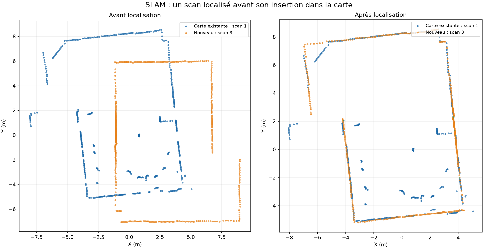
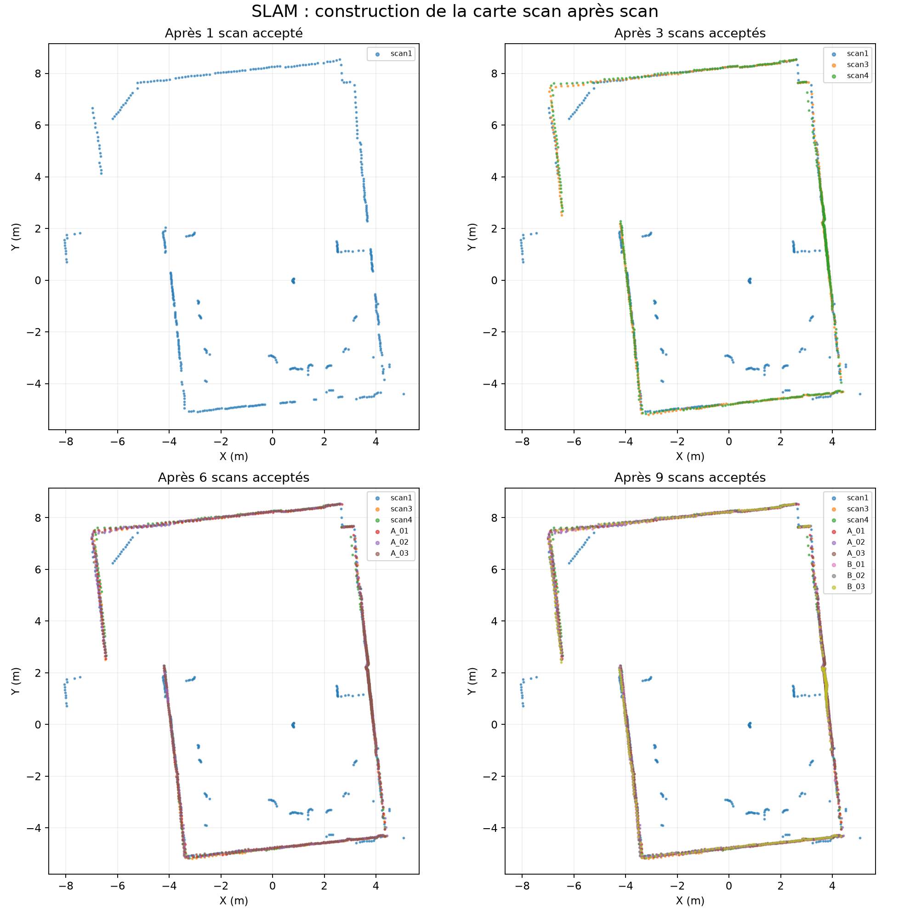
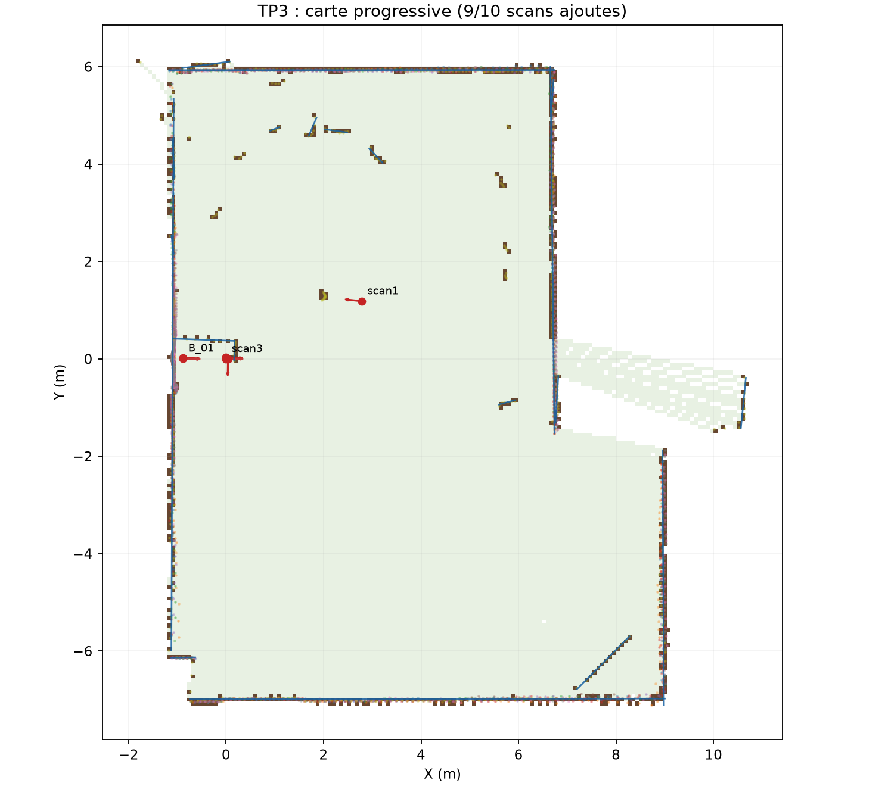

# TP3 — Partie SLAM : localisation et construction de la carte

**Auteur : Houssam MAKHLOUK — EIGSI, 2026/2027**

Cette page présente le rejeu incrémental des scans LD06 de la salle. Le
[programme SLAM](slam.py) lit les CSV dans l'ordre d'acquisition. Il localise
chaque scan par rapport à la carte déjà construite, puis met à jour cette carte.
Les figures ci-dessous sont calculées depuis les CSV et les poses obtenues par
le programme ; ce ne sont pas des plans dessinés à la main.

## 1. Comment fonctionne la boucle

1. Le scan 1 fixe le repère de la carte : `x = 0 m`, `y = 0 m`, `angle = 0°`.
2. Pour le scan suivant, le programme propose cinq poses de départ à partir de
   la dernière pose estimée et des centres des nuages. Il n'utilise pas les
   poses enregistrées dans les TP1 et TP2.
3. La recherche multirésolution du TP2, suivie d'ICP, cherche la pose qui
   superpose le nouveau scan aux points déjà intégrés.
4. Le programme vérifie le recouvrement et le score. Si le scan passe ces
   seuils, il transforme ses points par `point_carte = R(angle) × point_local + (x,y)`.
5. La grid map du TP1 est agrandie au besoin : les cellules traversées par les
   rayons deviennent libres et les impacts deviennent occupés. Les segments
   extraits du scan alimentent également la carte vectorielle.
6. La carte ainsi mise à jour sert de référence au prochain scan.

Cette séquence est un **début de SLAM sur données enregistrées** : localisation
et cartographie s'alimentent à chaque étape. Elle ne comprend ni fermeture de
boucle, ni optimisation globale des anciennes poses, ni pilotage du robot.

## 2. Exemple réel : recalage du scan 3

Le scan 2 est écarté par le contrôle de qualité. Le scan 3 est donc localisé
par rapport à la carte qui contient alors le scan 1. À gauche, ses points
restent dans son repère local ; à droite, ils sont placés dans le repère de la
carte après estimation de la pose. Les courts traits verts indiquent un
échantillon de correspondances à moins de 20 cm.



Pour cet exemple, la pose estimée est environ **(2,65 m ; 1,45 m ; −174,18°)**,
avec **86,6 %** des points du scan 3 à moins de 30 cm de la carte existante.
Il s'agit d'un indicateur de cohérence du recalage, pas d'une erreur mesurée
par rapport à une position terrain.

## 3. Carte construite progressivement

La figure montre les points présents après 1, 3, 6 puis 9 scans acceptés.
Chaque couleur correspond à une acquisition. Les murs communs se superposent
progressivement lorsque les poses sont cohérentes.



La grille et les segments finaux sont visibles sur la carte ci-dessous :



## 4. Résultat et limites

Sur dix scans candidats à hauteur annoncée de 1,90 m, **neuf sont intégrés** :
4 159 points valides et **17 segments** dans la carte vectorielle finale. Le
scan 2 a un score de 0,189 m², supérieur au seuil choisi de 0,11 m² ; son
insertion dans la carte principale risquerait de fausser les obstacles. Une
[carte exploratoire](resultats/carte_exploratoire.png) montre séparément ce
qu'il ajouterait.

Les acquisitions N1 à N6 ne sont pas fusionnées dans cette coupe : cinq ont
une hauteur estimée différente et N4 a été pris au sol. Les positions physiques
des prises et les dimensions de la salle n'ont pas été mesurées indépendamment.
La carte représente donc **les surfaces observées**, sans preuve que chaque
zone cachée de la salle est couverte ni mesure de l'erreur absolue.

## 5. Reproduire les figures et le rapport

Depuis la racine du dépôt :

```powershell
python tp3/slam.py
python tp3/generer_figures_slam.py
python tp3/creer_rapport.py
```

Le [rapport PDF](rapport/rapport_tp3.pdf), les [poses estimées](resultats/poses_et_qualite.csv)
et le [diagnostic détaillé](resultats/diagnostic.json) accompagnent ces figures.
