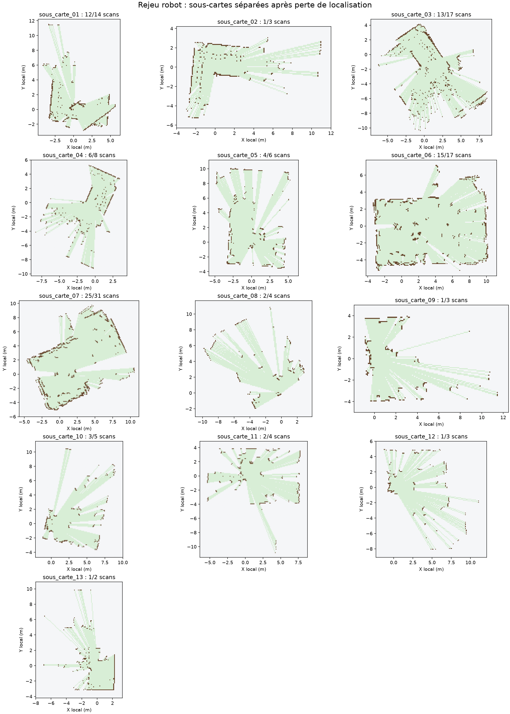

# TP3 bonus — robot mobile et cartographie incrémentale

Ce dossier ajoute au TP3 un **rejeu des scans acquis avec le robot** et un mode
de pilotage automatique limité. Le programme réutilise la conversion LD06 et la
grid map du TP1, ainsi qu'un recalage ICP local entre acquisitions. Les données
du robot sont enregistrées dans `donnees/`. Le CSV `tous_scans_ld06_20261104_164353.csv`
contient déjà les scans présents dans les cinq exports `tous_scans` antérieurs :
ces exports sont archivés dans `donnees/exports_cumulatifs/`, mais ne sont pas
additionnés au calcul pour éviter les doublons.

## Résultat sur les CSV reçus

Le dernier export cumulatif contient 114 scans. Quatre CSV individuels ont été
ajoutés ensuite ; un est un doublon exact : **117 scans distincts** ont donc été
rejoués. Le contrôle de qualité accepte **86 scans** dans **13 sous-cartes**.
Les sous-cartes ont chacune leur origine : elles ne peuvent pas être assemblées
en une carte globale sans pose de liaison ou fermeture de boucle fiable.
Une perte de recouvrement entre scans, des objets mobiles et des acquisitions
prises pendant un changement de pose peuvent expliquer ces ruptures ; le CSV
seul ne permet pas d'en isoler la cause avec certitude.



Chaque dossier `resultats_rejeu/sous_carte_XX/` contient une grille CSV/NPZ,
une trajectoire estimée et une image `slam_mobile.png`. La [sous-carte 07](resultats_rejeu/sous_carte_07/slam_mobile.png)
est la plus longue séquence continue de ce lot : 25 scans acceptés sur 31.
[Bilan JSON](resultats_rejeu/bilan_rejeu.json).

### Vue regroupée exploratoire

Les 13 sous-cartes ont aussi été recalées **indépendamment** sur la
[carte exploratoire TP3 antérieure](../resultats/carte_exploratoire.png) par
recherche grossière de pose puis ICP. Le résultat est une [vue regroupée](resultats_rejeu/carte_regroupee_exploratoire.png)
semblable à une carte de salle, et non une preuve que les 13 poses sont justes.
Avec les seuils indicatifs de 35 % des cellules occupées à moins de 30 cm et un
score au plus égal à 0,12 m², **six raccords sont plausibles et sept restent
incertains**. Les raccords incertains sont affichés plus pâles. Les poses,
scores et points projetés sont dans [raccords_exploratoires.csv](resultats_rejeu/raccords_exploratoires.csv)
et [points_regroupes_exploratoires.csv](resultats_rejeu/points_regroupes_exploratoires.csv).
La grille de fond provient des anciens scans TP3 : elle sert de repère et ne
prouve pas que les nouveaux scans, à eux seuls, couvrent toute la pièce.

Pour régénérer cette vue après le rejeu :

```powershell
python tp3/bonus_robot/fusion_exploratoire.py
```

`pose_x`, `pose_y` et `pose_angle_deg` du CSV ne sont **pas** une odométrie :
le firmware écrit dans le paquet les valeurs manuellement saisies via `/pose`.
Elles valent ici 0 et ne sont pas utilisées pour calculer les trajectoires.

## Reproduire le rejeu

Depuis la racine du dépôt :

```powershell
python tp3/bonus_robot/mobile_slam.py `
  --combined tp3/bonus_robot/donnees/tous_scans_ld06_20261104_164353.csv `
  --single tp3/bonus_robot/donnees/scan_20261104_164421.csv `
           tp3/bonus_robot/donnees/scan_20261104_164632.csv `
           tp3/bonus_robot/donnees/scan_20261104_164926.csv `
           tp3/bonus_robot/donnees/scan_20261104_165007.csv `
  --output tp3/bonus_robot/resultats_rejeu
```

## Déplacement automatique et carte en direct

Le firmware joint interrompt la lecture LiDAR pendant une impulsion moteur et
ne fournit ni odométrie ni angle de roue. Le mode direct suit donc la boucle :

1. robot arrêté, attendre un scan LiDAR récent ;
2. vérifier le dégagement devant le robot ;
3. localiser ce scan et actualiser la grille ;
4. envoyer une courte impulsion `/forward`, attendre son arrêt et appeler `/stop` ;
5. recommencer tant que le recalage et le dégagement restent suffisants.

Il s'agit d'un **pilotage automatique par impulsions avec cartographie entre
les mouvements**, pas d'une cartographie LiDAR continue pendant que les moteurs
tournent. Le programme ne tourne pas automatiquement autour des obstacles :
il s'arrête pour garder la carte et la trajectoire interprétables.

Connecter le PC au point d'accès du robot, dégager le trajet, garder le bouton
STOP de l'interface disponible, puis lancer depuis la racine du dépôt :

```powershell
python tp3/bonus_robot/mobile_slam.py --drive --steps 10 --min-clearance 0.9
```

`--drive` est indispensable : sans cette option, aucun moteur n'est commandé.
Le programme arrête le robot si le LiDAR ne fournit pas de nouveau scan frais,
si le secteur avant est mal observé, si un obstacle est trop proche, si la
localisation échoue ou quand le nombre d'impulsions demandé est atteint.
Chaque scan direct est conservé dans `resultats_mobile/scans_bruts/` ; la grille,
la trajectoire CSV et l'image sont mises à jour après chaque arrêt.

La connexion matérielle n'était pas accessible lors de la création de ce code :
le mode direct a été vérifié avec un faux robot dans les tests, mais **pas sur le
robot physique**. Les distances de sécurité doivent être contrôlées sur place.

## Contrôles et limites

```powershell
python -m unittest discover -s tp3/bonus_robot -p "test_*.py" -v
```

Le scan matching est local et peut dériver. Une sous-carte ne devient pas une
mesure absolue de la salle. Les personnes, meubles déplacés, occultations et
hauteurs de capteur différentes dégradent les correspondances. Une carte
complète et métriquement validée demanderait des positions de référence
mesurées, un parcours avec recouvrement et une fermeture de boucle fiable.

Sources du robot fournies par l'utilisateur :
[firmware Arduino](robot_esp32_source.ino),
[page d'acquisition](enregistreur_scans_ld06.html),
[script d'acquisition](enregistrer_scans_ld06.py).
Le firmware utilise la bibliothèque Arduino `ld06.h` installée sur le poste de
développement ; elle n'est pas intégrée dans ce dossier.
